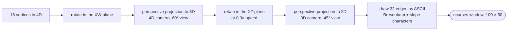

<div align="center">

# Tesseract-CLI

**A four-dimensional hypercube, rotating in your terminal.**

A tesseract is projected from 4D to 3D to 2D on every frame and drawn as ASCII art with ncurses.
Around 500 lines of plain C, no dependencies beyond ncurses.


</div>

---

## Highlights

- **Real 4D geometry.** The 16 vertices of a tesseract rotate in the XW plane, a plane that only exists in
  four dimensions, which is why the inner cube turns itself inside out.
- **Two perspective projections.** 4D to 3D with a 60° field of view, then 3D to 2D with 45°, each through
  its own camera, as in Hollasch's thesis.
- **Clean ASCII lines.** All 32 edges are drawn with Bresenham's algorithm, choosing `_` `-` `|` `/` `\` from
  the local slope, with `@` at the vertices.
- **Tiny and portable.** One C file, a short Makefile, ncurses for the screen. Builds cleanly with
  `-Wall -Wextra -Werror`, including Ubuntu's stricter format checks.

## How it works



The 4D camera sits at `(5, 0, 0, 0)` looking at the origin; its view matrix is built with the
four-dimensional cross product. The math follows chapter 4 of
[Four-Space Visualization of 4D Objects](https://hollasch.github.io/ray4/Four-Space_Visualization_of_4D_Objects.html#chapter4)
(Steven Hollasch, 1991).

## Quick start

**You need** a C compiler, `make` and the ncurses development files.

```bash
# Debian / Ubuntu
sudo apt install build-essential libncurses-dev
# Arch
sudo pacman -S base-devel ncurses
# macOS: ncurses comes with the Xcode command line tools (xcode-select --install)

git clone https://github.com/row-hammer/tesseract-cli.git && cd tesseract-cli
make
./hypercube
```

Press any key to quit. The picture is 100 × 50 characters, so make the terminal at least that big.

## Project layout

| File | What it is |
|---|---|
| `main.c` | everything: 4D and 3D math, the two projections, line drawing, the ncurses loop |
| `Makefile` | `make` builds `hypercube` (`-Wall -Wextra -Werror -O3`), `make clean` removes it |
| `sk.gif` | the demo above |

`CC` and `CFLAGS` can be set from the command line, e.g. `make CC=clang`.

## Troubleshooting

| Symptom | Fix |
|---|---|
| `ncurses.h: No such file or directory` | Install the ncurses development package (see Quick start). |
| Only part of the tesseract is visible | The terminal is smaller than 100 × 50: enlarge it or zoom out. |

---

<div align="center">
<sub>Based on <a href="https://hollasch.github.io/ray4/Four-Space_Visualization_of_4D_Objects.html#chapter4">Four-Space Visualization of 4D Objects</a> by Steven Hollasch (1991).<br/>
MIT licensed, see <a href="LICENSE">LICENSE</a>.</sub>
</div>
