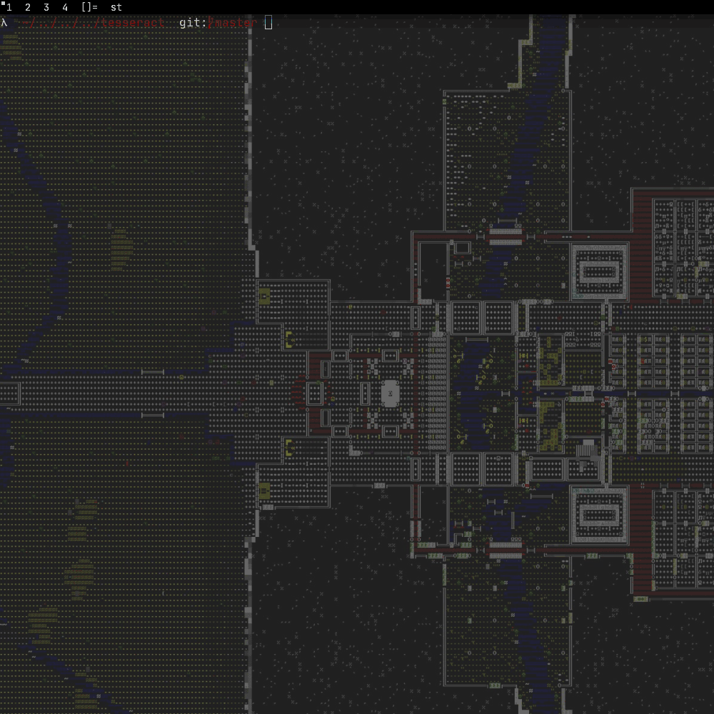

# Tesseract-CLI

Rotating tesseract ASCII projection using the ncurses library. The program is based on [Four-Space Visualization of 4D Objects](https://hollasch.github.io/ray4/Four-Space_Visualization_of_4D_Objects.html#chapter4) 1991

